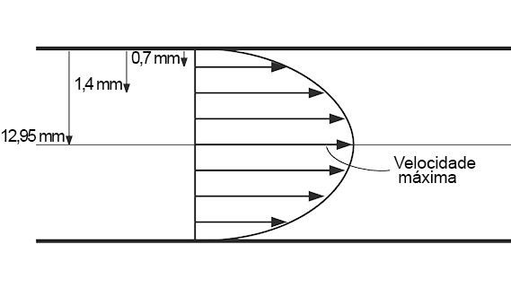
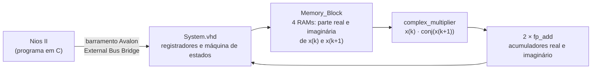
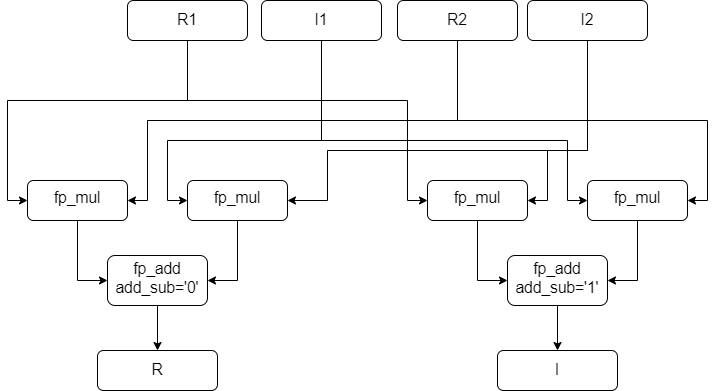
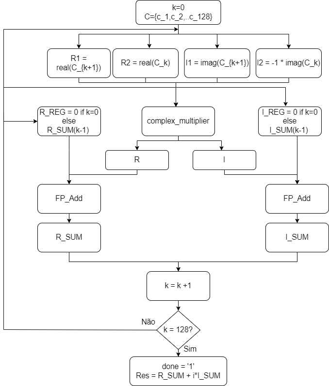

# Autocorrelação em VHDL para medição de velocidade por ultrassom

Implementação em **VHDL**, numa **FPGA Intel MAX 10 (kit DE10-Lite)**, do método de **autocorrelação** usado para estimar a velocidade de escoamento de fluidos a partir de ecos de ultrassom (efeito Doppler pulsado). Todo o cálculo é feito em **ponto flutuante IEEE 754 de precisão simples**, com somador e multiplicador escritos do zero, e um processador **Nios II** envia os dados e lê o resultado. Foi o meu Trabalho de Conclusão de Curso em Engenharia Eletrônica na UTFPR, em 2022.

> **English:** my undergraduate thesis (UTFPR, 2022). A VHDL implementation of the autocorrelation velocity estimator for pulsed Doppler ultrasound on an Intel MAX 10 FPGA (DE10-Lite), using hand-written IEEE 754 single-precision adder and multiplier and a Nios II soft processor for I/O. Compared with the MATLAB reference, the velocity error stayed below 0.00002%.

📄 [Texto completo do TCC (PDF)](docs/TCC-Isadora-Schmidt-2022.pdf)

## O problema

Para estimar a velocidade de uma partícula num tubo ou rio, um transdutor emite pulsos de ultrassom e recebe os ecos. A cada pulso, o sinal refletido muda um pouco de fase, e essa mudança é proporcional à velocidade. O método de autocorrelação estima essa fase com a autocorrelação de lag 1 do sinal complexo demodulado,

$$R(1) = \sum_{k=0}^{N-2} x(k)\,\overline{x(k+1)} \qquad v = \frac{c \cdot PRF}{4\pi f_c}\,\arg\big(R(1)\big)$$

em que $c$ é a velocidade do som, $PRF$ a frequência de repetição dos pulsos e $f_c$ a frequência do transdutor. A FPGA calcula $R(1)$ para 128 emissões.

Os dados de teste são medições reais de um escoamento de água a 1 m/s, adquiridas antes deste trabalho com um transdutor de 4 MHz e 128 pulsos a 6 kHz, nas três posições do tubo mostradas abaixo.



## Arquitetura



| Módulo | Função |
|---|---|
| `System.vhd` | Topo do projeto. Decodifica o barramento do Nios II, guarda as amostras na memória e controla a máquina de estados da autocorrelação |
| `Memory_Block.vhd` e `RAM.vhd` | Quatro memórias de porta dupla, que entregam a cada passo as partes real e imaginária de duas amostras consecutivas |
| `complex_multiplier.vhd` | Multiplicação complexa com quatro `fp_mul` e dois `fp_add` |
| `fp_mul.vhd` | Multiplicador IEEE 754, com tratamento de NaN, infinito, zero, overflow e underflow |
| `fp_add.vhd` | Somador e subtrator IEEE 754, com alinhamento de expoentes e arredondamento |
| `right_shifter.vhd` | Deslocamento da mantissa com bit *sticky* para o arredondamento |
| `fp_leading_zeros_and_shift.vhd` | Normalização do resultado (contagem de zeros à esquerda) |



### Mapa de endereços

| Endereço da palavra | Endereço em bytes (Nios II) | Conteúdo |
|---|---|---|
| 0 a 255 | `0x000` a `0x3FC` | 128 amostras complexas, com parte real e imaginária intercaladas |
| 256 e 257 | `0x400` e `0x404` | Resultado, parte real e imaginária |
| 512 | `0x800` | CTRL, em que o bit 0 inicia o cálculo |
| 513 | `0x804` | STATUS, em que o bit 0 indica que terminou |

### Máquina de estados

| Estado | O que faz |
|---|---|
| s0 | Zera os acumuladores e aponta para as amostras 0 e 1. Espera o comando de início |
| s1, s2 | Espera a leitura da memória e o cálculo combinacional do produto e da soma |
| s3 | Guarda a soma parcial nos acumuladores |
| s4 | Avança para o próximo par ou termina depois dos 127 pares |
| s5 | Sinaliza o fim e espera o Nios II confirmar a leitura |



## Resultados

Comparação entre a autocorrelação calculada pela FPGA (32 bits) e pelo MATLAB (64 bits), com os mesmos dados.

| Posição | Velocidade (MATLAB) | Velocidade (FPGA) | Erro relativo |
|---|---|---|---|
| 0,7 mm | 0,519407012587701 m/s | 0,519406919299993 m/s | 0,000018% |
| 1,4 mm | 0,768806383177909 m/s | 0,768806405649854 m/s | 0,0000029% |
| 12,95 mm | 1,087659773018363 m/s | 1,087659724278251 m/s | 0,0000045% |

**Uso da FPGA (10M50DAF484C7G)**

| Recurso | Uso |
|---|---|
| Elementos lógicos | 7.653 de 49.760 (15%) |
| Bits de memória | 1.128.704 de 1.677.312 (67%) |
| Multiplicadores embarcados de 9 bits | 36 de 288 (13%) |

O erro ficou muito baixo, mas a precisão de 32 bits consome bastante memória, o que dificultaria usar uma FPGA menor e mais barata.

## Simulação no GHDL

A pasta `sim` permite rodar o sistema completo sem a placa. O arquivo `proc_sys_sim.vhd` substitui o Nios II por um modelo que faz no barramento a mesma sequência do programa em C. Ele escreve as 128 amostras, dá o comando de início, espera o fim e lê o resultado.

```bash
cd sim
./run_ghdl.sh
```

Saída esperada, que reproduz exatamente o valor da FPGA na posição 12,95 mm:

```
Autocorrelacao (FPGA): -5.321485625e5 + j(-1.685907625e6)
```

## Organização

| Pasta | Conteúdo |
|---|---|
| `rtl/` | Código VHDL do sistema |
| `nios/` | Programa em C do Nios II, com as 128 amostras da posição 12,95 mm |
| `quartus/` | Projeto do Quartus Prime 18.1 e sistema do Platform Designer (`proc_sys.qsys`) |
| `sim/` | Testbench e script para o GHDL |
| `matlab/` | Script que extrai as amostras complexas dos dados de aquisição |
| `docs/` | Texto do TCC e figuras |

Para gerar o projeto na placa, abra `quartus/autocorrelacao.qpf` no Quartus Prime 18.1, gere o `proc_sys.qsys` no Platform Designer e compile. Depois, crie a aplicação do Nios II no Nios II Software Build Tools com o arquivo `nios/main.c`. Os dados brutos do experimento não estão no repositório.

## O que eu faria diferente hoje

- **Precisão menor.** A conclusão do próprio trabalho é que, para uso em larga escala, a precisão poderia cair para 16 bits, com erro ainda aceitável e muito menos memória.
- **Pipeline.** O somador e o multiplicador são combinacionais e cada par leva quatro ciclos. Com registradores intermediários, daria para processar um par por ciclo e aumentar a frequência máxima.
- **Interrupção em vez de consulta.** O Nios II fica lendo o STATUS em laço, e a linha de interrupção do barramento está fixa em zero. Eu usaria essa interrupção para avisar o fim do cálculo.
- **Dados pela UART.** As 128 amostras estão fixas no programa em C. O sistema já tem uma UART, e eu a usaria para receber os dados de um computador.
- **Velocidade na própria FPGA.** O cálculo da fase, com `atan2`, ainda é feito fora. Um bloco CORDIC em VHDL fecharia a medição inteira em hardware.
- **Testes automatizados.** Hoje eu escreveria testbenches para cada módulo de ponto flutuante, comparando com valores de referência, além do teste do sistema completo.

---

Orientador: Prof. Fábio Rizental Coutinho · Desenvolvido por **Isadora Fernanda Zappe Schmidt** · [LinkedIn](https://www.linkedin.com/in/isadora-fernanda)
